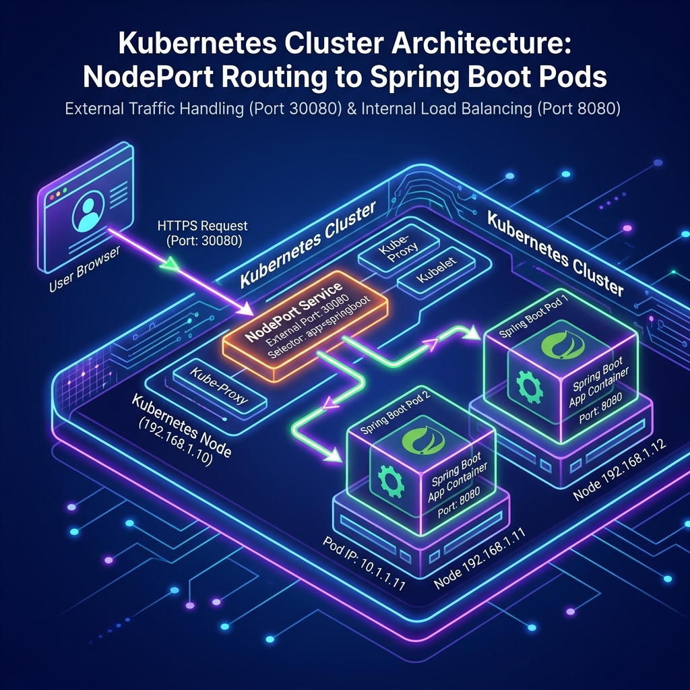
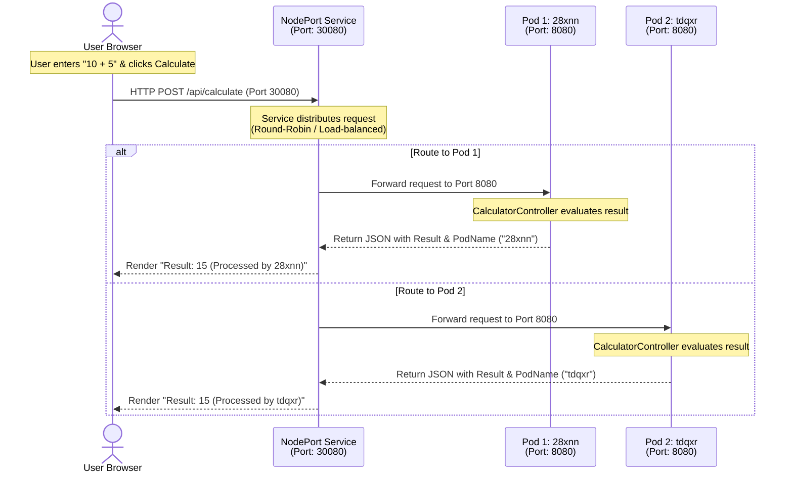

# Kubernetes Stateless Calculator PoC

This project is a simple, stateless **Calculator Web Application** built using **Java / Spring Boot** and deployed inside a local **Kubernetes (Minikube)** cluster. It serves as a hands-on introduction to containerization, Kubernetes configurations, services, and load balancing.

---

## 🏗️ Architecture Diagram

Here is how the request flow and networking work under the hood inside Kubernetes:



---

## 🔄 Request-Response Lifecycle Flow

The diagram below shows how the request is initiated from the browser, routed by the Kubernetes Service, and handled by one of the active Pods:



---

## 💡 Core Kubernetes Concepts Explained

### 1. Pod (The Smallest Compute Unit)
* **What it is**: A Pod is a wrapper around one or more running Docker containers. It shares network storage and IP addresses inside the K8s cluster.
* **In this project**: We have two calculator Pods running our Spring Boot application. Each Pod has a unique IP address and hostname (such as `calculator-deployment-6d4fb595f8-28xnn`).

### 2. Deployment (The Controller)
* **What it is**: A Deployment manages the lifecycle of your Pods. You tell it how many instances (replicas) you want, and it handles creating, updating, and restarting them if they crash (self-healing).
* **In this project**: Our `calculator.yaml` specifies `replicas: 2`. Kubernetes automatically ensures that 2 identical Pods are always running.

### 3. Service (The Load Balancer)
* **What it is**: Pods are temporary and get destroyed/recreated with new IP addresses. A Service provides a **single, stable IP address and DNS name** that forwards traffic to the correct Pods.
* **NodePort Service**: This specific service type opens a port directly on all Kubernetes node interfaces (e.g., port `30080`) to allow **external traffic** (from your Mac browser) into the internal cluster.
* **In this project**: The `calculator-service` acts as a load-balancer. It receives traffic on port `30080`, selects one of the healthy calculator Pods, and forwards the HTTP request to it on port `8080`.

### 4. Health Probes & Resource Limits (Resilience & Self-Healing)
* **Liveness Probe (`GET /api/health`)**: Kubernetes periodically polls the app. If the application deadlocks or becomes unresponsive, Kubernetes automatically restarts the container.
* **Readiness Probe (`GET /api/health`)**: Ensures the Pod only receives traffic through the Service once Spring Boot has fully initialized.
* **Resource Requests & Limits**: Guarantees predictable scheduling by requesting `100m` CPU / `256Mi` memory, capped at `500m` CPU / `512Mi` memory to prevent runaway resource consumption.

---

## 🛠️ Step-by-Step CLI Playbook

Use these terminal commands to manage and explore your local Kubernetes cluster:

### 1. Deploying the Application
```bash
# 1. Compile the Java code
cd app
./mvnw clean package -DskipTests

# 2. Build the Docker container image
docker build -t k8s-calculator:latest .

# 3. Load the local Docker image into Minikube's registry
minikube image load k8s-calculator:latest

# 4. Apply the Kubernetes deployment manifests
kubectl apply -f ../k8s/calculator.yaml
```

### 2. Monitoring Cluster State
```bash
# Get the list of running Pods and their status
kubectl get pods

# Get the list of exposed Services
kubectl get services

# View the detailed configuration and events of a Pod
kubectl describe pod <pod-name>
```

### 3. Debugging and Logs
```bash
# Stream logs from a specific pod
kubectl logs -f <pod-name>

# Stream logs across all pods sharing the 'app=calculator' label
kubectl logs -f -l app=calculator
```

### 4. Stopping and Cleaning Up
```bash
# Delete all resources created by the manifest
kubectl delete -f k8s/calculator.yaml

# Stop the Minikube cluster
minikube stop
```
